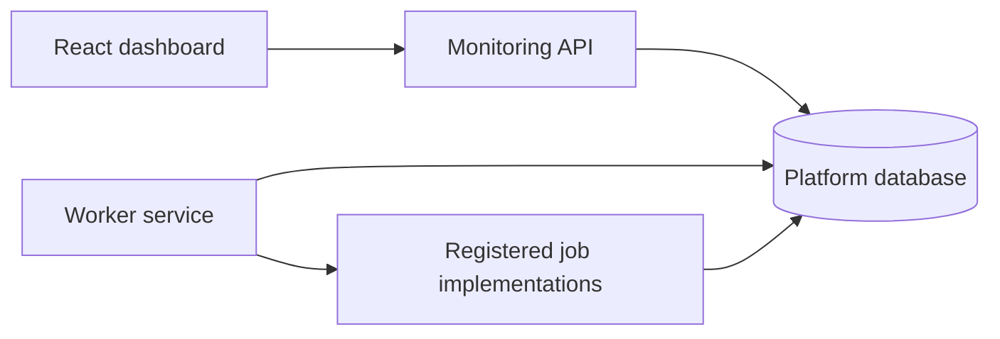

# .NET Background Job Monitoring Platform

A central platform for registering, scheduling, running, and monitoring background jobs from .NET applications. The worker runs as a separate process so one-minute and two-minute schedules continue even when an IIS-hosted API becomes idle.

## Architecture



| Project | Responsibility | Deployment |
| --- | --- | --- |
| `Monitoring.Contracts` | Job definitions, execution context, results, and registration contracts | Shared package or project reference |
| `Monitoring.Application` | Scheduling, dispatch, validation, history, and alerting use cases | Library |
| `Monitoring.Infrastructure` | Persistence, distributed coordination, and integrations | Library |
| `Monitoring.Api` | Dashboard API, administration, and health endpoints | IIS or standalone ASP.NET Core host |
| `Monitoring.Worker` | Due-job polling, dispatch, execution, recovery, and retention | Independent Windows Service or Linux systemd service |
| `monitoring-web` | React dashboard | Separately hosted static build |
| `Monitoring.Tests` | Scheduler, concurrency, API, and integration tests | CI |

These are proposed project names; the solution can be organized into folders without changing the deployment boundary. The worker and API share the platform database but have separate host processes. Applications register job implementations in the worker host through dependency injection. The platform supplies both a standard job runner and a scheduling mechanism; it also records jobs initiated manually or by an application.

## Job model

- A **job definition** identifies the implementation by a stable key and includes display name, description, enabled status, schedule, time zone, timeout, retry policy, and concurrency policy.
- A **schedule** supports a fixed interval (including one or two minutes) and, when implemented, a cron expression. Persist next due time in UTC and define how missed runs are handled.
- A **job run** records trigger source (schedule/manual/API), scheduled/start/end times, status, attempt number, worker identity, duration, error summary, and correlation ID.
- The runner resolves an implementation through dependency injection, creates a scope for each run, passes a cancellation token and execution context, and persists transitions and results.
- Implementations must use a stable key and be safe for retry. A removed implementation is shown as unavailable instead of causing the worker to crash.

## Execution and reliability

1. The worker polls persisted schedules, claims due work atomically, and advances the next due time in the same transaction. Database-backed leases or equivalent coordination prevent duplicate dispatch across worker instances.
2. Each run has its own execution claim and heartbeat. A stopped worker leaves a recoverable run; another worker marks it abandoned or retries it according to policy after the lease expires.
3. Apply per-job concurrency limits, execution timeout, cancellation on shutdown, bounded worker parallelism, and exponential retry with a maximum attempt count.
4. A manual trigger creates a durable run request and is subject to permissions and concurrency rules. Every attempt and final outcome is auditable.
5. Use UTC for storage, display times in the selected time zone, and handle daylight-saving transitions explicitly for calendar schedules.
6. Keep the API out of the scheduling path. IIS idle timeout or an API recycle must not stop the worker. The worker must itself be hosted as a continuously running service with operating-system restart policy.

The initial database provider and authentication mechanism should be chosen during implementation to fit the deployment environment. The design should support an offline or dark-site deployment: package dependencies, migrations, frontend assets, and deployment instructions must be available without runtime internet access.

## Dashboard and API

The dashboard shows overall health, due and running jobs, success/failure trends, recent runs, failure details, duration, and worker heartbeat. Job detail includes schedule, next run, last run, run history, attempts, and controls to enable/disable or run now. Server-side filters and pagination cover large histories. The API exposes definition and run queries, authorized administration commands, worker health/readiness, and structured error responses. Never expose secrets or raw sensitive payloads in logs or responses.

## Local development

### Run the application step by step (Windows PowerShell)

You will use **four terminals**: one for the database (briefly), then one each for the worker, the API and the dashboard. The worker and API are separate processes on purpose, so you can stop the API and watch scheduled jobs keep running.

**Step 0 – Prerequisites.** Install and check:

| Tool | Needed | Check |
| --- | --- | --- |
| .NET SDK | 10.0.x (pinned to 10.0.401 in `global.json`) | `dotnet --version` |
| Node.js | 20 or newer | `node --version` |
| Docker Desktop | running, used for SQL Server | `docker --version` |

If `dotnet --version` does not print `10.x` (for example because the SDK is installed per-user in `%USERPROFILE%\.dotnet`), run this **in every terminal** before any `dotnet` command:

```powershell
$env:PATH = "$env:USERPROFILE\.dotnet;$env:PATH"; $env:DOTNET_ROOT = "$env:USERPROFILE\.dotnet"
```

**Step 1 – Get to the repository folder** (all `dotnet` and `docker` commands run from here):

```powershell
cd E:\POC\monitoring
```

**Step 2 – Start SQL Server (Terminal 1).** This starts SQL Server 2022 in Docker on `localhost,14333`; it takes about 15–20 seconds to accept connections:

```powershell
docker compose up -d
docker ps --filter name=monitoring-sql      # STATUS should say "Up"
```

The default development SA password is `Dev_Passw0rd!` (set `MSSQL_SA_PASSWORD` in a `.env` file to change it; if you do, also change the development connection strings, see the configuration table below). Data is kept in the `sqldata` Docker volume.

**Step 3 – Start the worker (Terminal 2).** The worker creates the database schema on first start and seeds three sample jobs. Leave it running:

```powershell
cd E:\POC\monitoring
$env:DOTNET_ENVIRONMENT = "Development"
dotnet run --project src/Monitoring.Worker --no-launch-profile
```

Success looks like `Applying migrations`, then `Runner started as worker …`, then `SampleJob run … Succeeded` lines every minute.

**Step 4 – Start the API (Terminal 3).** Leave it running:

```powershell
cd E:\POC\monitoring
$env:ASPNETCORE_ENVIRONMENT = "Development"
dotnet run --project src/Monitoring.Api --no-launch-profile --urls http://localhost:5284
```

Check it: open <http://localhost:5284/health/ready> (should print `Healthy`) or browse the API at <http://localhost:5284/swagger>.

**Step 5 – Start the dashboard (Terminal 4).** The first time only, install dependencies and create the local env file:

```powershell
cd E:\POC\monitoring\src\monitoring-web
copy .env.example .env.local        # first time only
npm install                         # first time only
npm run dev
```

**Step 6 – Open the dashboard.** Go to <http://localhost:5173> and sign in with the **Development sign-in** form: enter any name and choose a role.

| Role | Can do |
| --- | --- |
| `viewer` | View everything; no controls |
| `operator` | Also **Run now** and **Enable/Disable** jobs |
| `administrator` | Also edit job settings (via the API) and read the audit log |

(`POST /api/v1/auth/dev-token` exists **only** when `Api:EnableDevTokens=true`, which the API refuses to start with outside Development.)

**Step 7 – Try it.**

1. **Overview** shows success rate, running/queued counts and the worker as *online*. Within a minute `sample.job` runs appear under **Runs**.
2. Open **Jobs → Sample flaky job → Run now** (sign in as `operator`). Its first attempt fails and is retried after a short backoff; open the run to see both attempts and the redacted error.
3. Go back to Terminal 3 and press `Ctrl+C` to stop the API. Watch Terminal 2: new runs keep executing. Restart the API with the Step 4 command and the history is all there.

**Step 8 – Stop everything.** Press `Ctrl+C` in the dashboard, API and worker terminals (the worker finishes or re-queues running jobs gracefully), then:

```powershell
cd E:\POC\monitoring
docker compose stop        # keeps your data; use "docker compose down -v" to also delete the database
```

To start again later, repeat Steps 2–5 (skip the "first time only" lines).

### Troubleshooting

| Symptom | Fix |
| --- | --- |
| `A compatible .NET SDK was not found` / wrong `dotnet --version` | Use the PATH snippet in Step 0 in that terminal. |
| Worker or API: `Connection string 'ConnectionStrings:Monitoring' is not configured` | You are not in Development mode: set `$env:DOTNET_ENVIRONMENT` / `$env:ASPNETCORE_ENVIRONMENT = "Development"` in that terminal (variables do not carry across terminals). |
| Worker: `Cannot open server` / login timeouts right after `docker compose up` | SQL Server is still starting; wait ~20 s and re-run the worker. |
| Port already in use (5284 or 5173) | Stop the old process, or change `--urls` / the Vite port (and add the new origin to `Api:AllowedOrigins`). |
| Dashboard shows a red "No worker has reported a heartbeat" banner | The worker (Step 3) is not running or cannot reach the database. |
| Dashboard login fails with a network error | The API (Step 4) is not running, or `VITE_API_BASE_URL` in `.env.local` does not match its URL. Restart `npm run dev` after editing `.env.local`. |
| Want a clean database | `docker compose down -v`, then repeat from Step 2. |

Configuration keys (appsettings, user-secrets or environment variables with `__`, e.g. `ConnectionStrings__Monitoring`):

| Key | Default | Meaning |
| --- | --- | --- |
| `ConnectionStrings:Monitoring` | none (required) | SQL Server connection string; startup fails with a clear message if missing |
| `Worker:PollIntervalSeconds` / `LeaseSeconds` / `HeartbeatSeconds` | 2 / 60 / 15 | Poll cadence; run lease length (must be ≥ 2× heartbeat); heartbeat period |
| `Worker:MaxParallelism` / `SchedulerBatchSize` / `ShutdownGraceSeconds` | 4 / 50 / 30 | Concurrent runs per worker; schedules claimed per poll; wait for running jobs on shutdown |
| `Worker:ApplyMigrationsOnStartup` / `SeedSampleData` | false | Development conveniences only |
| `Api:JwtKey` (≥ 32 chars), `JwtIssuer`, `JwtAudience` | none (required key) | Token validation; supply the key from secure configuration |
| `Api:AllowedOrigins` | `[]` | CORS origins for the dashboard |
| `Api:WorkerStaleSeconds` | 45 | Heartbeat age after which a worker shows stale (offline at 4×) |
| `VITE_API_BASE_URL` | `http://localhost:5284` | Dashboard API base URL (build time) |

Verify the key behaviour: scheduled `sample.job` runs appear every minute; stop the API and confirm new runs keep being recorded (the worker owns scheduling); start a second worker and check no occurrence runs twice; hard-kill a worker mid-run and watch the other recover it after the lease expires (attempt 1 `Abandoned`, attempt 2 runs elsewhere).

Tests: `dotnet test` (unit tests need nothing; the API integration tests use a throwaway `Monitoring_Test` database on the Docker SQL Server, override with `MONITORING_TEST_CS`) and `cd src/monitoring-web; npm test`.

### Behaviour worth knowing

- **Missed runs** (per job, default `CoalesceOne`): after downtime, one run for the latest missed occurrence is enqueued; `Skip` drops missed occurrences; `CatchUpCapped` enqueues up to 5. The next due time stays anchored to the original cadence (no drift).
- **Overlap** (per job, default `SkipIfRunning`): a scheduled occurrence that comes due while the previous run is still active is recorded as `Cancelled` ("Skipped: previous run still active"); manual runs wait in the queue instead.
- **Retries:** failed or timed-out runs retry with exponential backoff (`RetryBaseDelaySeconds`, doubling) up to `MaxAttempts`; a graceful worker shutdown re-queues a running job without consuming an attempt.
- **At-least-once:** if a worker dies mid-run the run is recovered after its lease expires, so job code must be idempotent.
- Error text is truncated and has `password=`/`token=`-style values redacted before it is stored or returned.

Not yet implemented: cron schedules, retention cleanup, alert channels, schedule editing from the dashboard (the API supports it via `PUT /api/v1/jobs/{key}`), and the Phase 5 deployment scripts and runbook.

## Deployment

1. Build and publish the API, worker, and frontend independently using pinned, internally available dependencies. Supply the appropriate ASP.NET Core hosting bundle for IIS if applicable.
2. Provision the platform database and apply versioned migrations as a controlled deployment step. Back up before schema changes.
3. Configure both API and worker with the same database, separate credentials where possible, and secrets from the host's secure configuration. Configure base URL, allowed origins, authentication, time zone defaults, retention, polling interval, lease duration, and maximum concurrency.
4. Host `Monitoring.Api` in IIS or as an ASP.NET Core service. Host `Monitoring.Worker` as a **Windows Service** or **systemd** service with automatic startup and restart on failure. Do not depend on the IIS application pool to run scheduled jobs.
5. Host the React production build on the chosen static web server and route its API requests to the deployed API. Protect both with HTTPS at the appropriate ingress and restrict administrative operations.
6. Start the worker, verify readiness and heartbeat, register a test job, and confirm a scheduled execution and its history. Stop or recycle the API and confirm scheduled execution continues. Restart a worker during a run and verify recovery and duplicate protection.
7. Monitor worker liveness, last successful dispatch, overdue schedules, failed runs, database availability, and disk/history growth. Set retention and backups before production use.

## Integrating independently deployed applications

`Monitoring.Contracts` currently supports job implementations registered inside `Monitoring.Worker`. There is no ingestion API or reusable publisher library for jobs that execute in other applications. The proposed `Monitoring.Publisher` package will send authenticated, idempotent run lifecycle events to the API, which will display them alongside worker-run jobs while keeping their execution ownership separate. See the external application publisher section of [task.md](task.md) for the contract, security model, acceptance checks, and remaining work.
