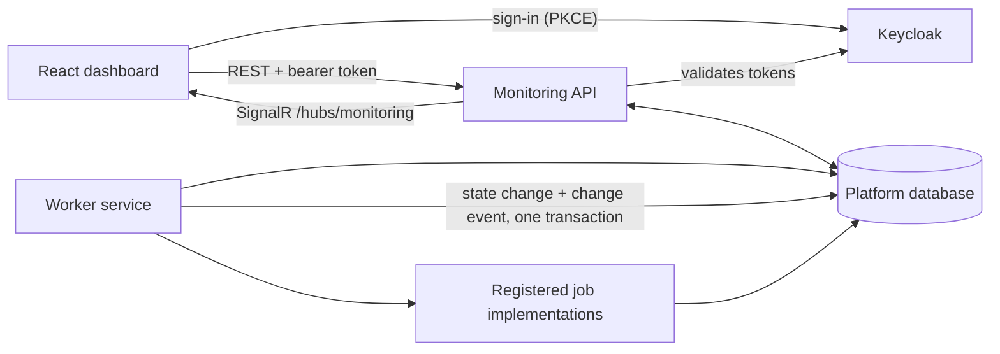

# .NET Background Job Monitoring Platform

A central platform for registering, scheduling, running, and monitoring background jobs from .NET applications. The worker runs as a separate process so one-minute and two-minute schedules continue even when an IIS-hosted API becomes idle.

## Architecture



The worker never talks to the API or to Keycloak: it only uses the shared database, so scheduling and execution continue when the API is stopped, recycled or idle.

| Project | Responsibility | Deployment |
| --- | --- | --- |
| `Monitoring.Contracts` | Job definitions, execution context, results, and registration contracts | Shared package or project reference |
| `Monitoring.Application` | Scheduling, dispatch, validation, history, and alerting use cases | Library |
| `Monitoring.Infrastructure` | Persistence, distributed coordination, and integrations | Library |
| `Monitoring.Api` | Dashboard API, administration, and health endpoints | IIS or standalone ASP.NET Core host |
| `Monitoring.Worker` | Due-job polling, dispatch, execution, recovery, and retention | Independent Windows Service or Linux systemd service |
| `monitoring-web` | React dashboard | Separately hosted static build |
| `Monitoring.Tests` | Scheduler, concurrency, API, and integration tests | CI |

These are proposed project names; the solution can be organized into folders without changing the deployment boundary. The worker and API share the platform database but have separate host processes. Applications register job implementations in the worker host through dependency injection. The platform supplies both a standard job runner and a scheduling mechanism; it also records jobs initiated manually or by an application.

## Job model

- A **job definition** identifies the implementation by a stable key and includes display name, description, enabled status, schedule, time zone, timeout, retry policy, and concurrency policy.
- A **schedule** supports a fixed interval (including one or two minutes) and, when implemented, a cron expression. Persist next due time in UTC and define how missed runs are handled.
- A **job run** records trigger source (schedule/manual/API), scheduled/start/end times, status, attempt number, worker identity, duration, error summary, and correlation ID.
- The runner resolves an implementation through dependency injection, creates a scope for each run, passes a cancellation token and execution context, and persists transitions and results.
- Implementations must use a stable key and be safe for retry. A removed implementation is shown as unavailable instead of causing the worker to crash.

## Execution and reliability

1. The worker polls persisted schedules, claims due work atomically, and advances the next due time in the same transaction. Database-backed leases or equivalent coordination prevent duplicate dispatch across worker instances.
2. Each run has its own execution claim and heartbeat. A stopped worker leaves a recoverable run; another worker marks it abandoned or retries it according to policy after the lease expires.
3. Apply per-job concurrency limits, execution timeout, cancellation on shutdown, bounded worker parallelism, and exponential retry with a maximum attempt count.
4. A manual trigger creates a durable run request and is subject to permissions and concurrency rules. Every attempt and final outcome is auditable.
5. Use UTC for storage, display times in the selected time zone, and handle daylight-saving transitions explicitly for calendar schedules.
6. Keep the API out of the scheduling path. IIS idle timeout or an API recycle must not stop the worker. The worker must itself be hosted as a continuously running service with operating-system restart policy.

The initial database provider and authentication mechanism should be chosen during implementation to fit the deployment environment. The design should support an offline or dark-site deployment: package dependencies, migrations, frontend assets, and deployment instructions must be available without runtime internet access.

## Dashboard and API

The dashboard shows overall health, due and running jobs, success/failure trends, recent runs, failure details, duration, and worker heartbeat. Job detail includes schedule, next run, last run, run history, attempts, and controls to enable/disable or run now. Server-side filters and pagination cover large histories. The API exposes definition and run queries, authorized administration commands, worker health/readiness, and structured error responses. Never expose secrets or raw sensitive payloads in logs or responses.

## Active/standby workers

By default (`Worker:LeaderMode=ActiveStandby`) **only one worker process per Monitoring database schedules and executes jobs at a time**. Run the worker on two (or more) machines or services: one is *active*, the others are healthy *standbys* that take over automatically. This protects against a node or service failure; it does not add throughput (for that, use `Disabled`, below).

**How it works.** Every node tries to take one exclusive SQL Server application lock (`sp_getapplock`, `@LockOwner='Session'`, `@LockTimeout=0`, resource `Worker:LeaderLockResource`) on its **own dedicated, non-pooled connection** to the Monitoring database. The lock is database-scoped, so it only applies to that database, and it is never a transaction lock or an EF/pooled connection. Whoever gets it is active; everyone else retries every `Worker:StandbyRetrySeconds`.

| | Active node | Standby node |
| --- | --- | --- |
| Holds the leader lock | yes (connection kept open for the whole tenure) | no, retries quietly |
| Startup initialiser (migrations in dev, job definitions, seed) | runs once per tenure | **never runs** |
| Registers job capabilities and heartbeats (appears in the dashboard) | yes | **no**: it advertises nothing, so job availability never counts it |
| Scheduler, lease recovery, runner, change-feed cleanup | running | **not running** |
| Log line | `Worker … is ACTIVE (leader lock … held by SQL session N)` | `Worker … is STANDBY: another node holds the leader lock` (logged once, then Debug) |

The dashboard has no separate standby view: the **Workers** list shows the active node only, and the standby is visible in its own log. Lock contention is an ordinary result, not an error: it is never logged above Debug after the first line. The service's `StartAsync` returns immediately whether or not the node wins, so Windows Service start never waits for leadership.

**Staying leader (fail closed).** Every `Worker:LeaderCheckSeconds` the active node verifies on the lock connection that it is still the same SQL session and still holds the lock (`@@SPID` + `APPLOCK_MODE`). If that cannot be proven (session killed, connection broken or timed out, SQL unreachable), the node does **not** reconnect and carry on as leader. It immediately:

1. stops claiming runs and scheduling,
2. cancels every running job and stops renewing their leases,
3. discards whatever those jobs return (nothing is written for those attempts; the per-attempt fencing in `RunStore` would reject a stale write anyway),
4. stops its loops, closes the lock connection and goes back to standby, waiting at least `StandbyRetrySeconds` (longer, with back-off up to 60 s, if this keeps happening) before it competes again.

The attempts that were running stay `Running` until their lease expires (`Worker:LeaseSeconds`); the next active node then recovers them under the normal at-least-once policy (attempt `Abandoned`, a new attempt runs, charged to the retry budget).

**Failover.**

| Event | What happens |
| --- | --- |
| Graceful stop (service stop, deployment) | The runner cancels and re-queues running jobs (not charged), waits up to `Worker:ShutdownGraceSeconds`, the loops stop, **then** the lock is released and closed. A standby takes it on its next retry (within `StandbyRetrySeconds`). |
| Process or machine crash | SQL Server ends the session and frees the lock; a standby takes over within `StandbyRetrySeconds`, plus up to `LeaseSeconds` before runs that were executing are recovered. |
| SQL session lost but process alive (network, `KILL`) | The old leader notices within `LeaderCheckSeconds`, stops as above; a standby takes over. |
| SQL Server down | The active node cannot prove ownership and stands down; every node waits, logging a warning only when the error changes, and competes again with back-off when the database is back. |
| Former leader restarts | It comes back as a standby and does not disturb the new leader. There is no automatic fail-back. |

**What this does and does not guarantee.** It keeps one node scheduling and executing, so a node failure costs seconds, not a stopped system. It is **not** exactly-once. Between the old leader losing its session and *noticing* (up to `LeaderCheckSeconds`) a successor may already be scheduling. The existing protections remain as the second layer and keep that safe: due schedules are claimed atomically (`UPDLOCK, READPAST` with the next-due advance in one transaction), runs are claimed under a database lock, and every write for an attempt is a compare-and-set on run + worker instance + attempt number. A job that **ignores its `CancellationToken`** keeps running after a failover and can overlap with the retried attempt on the new node; jobs must stay idempotent.

**`LeaderMode=Disabled`.** Every node is active (the pre-election behaviour). Use it only if you deliberately want several active workers sharing the load; duplicate protection then rests on the claim and fencing layers alone. Both modes use the same code path, and the multi-worker tests (`MultiWorkerTests`, `AttemptAndRecoveryTests`) deliberately run in this mode.

**Development note.** With `Worker:ApplyMigrationsOnStartup=true` and a database that does not exist yet, the first node creates it (migrations) so that there is a database to take the lock in; that is the only thing a node does before it is active. In production apply migrations as a controlled deployment step.

## Data retention

A nightly cleanup keeps the database bounded. It lives entirely in the worker (no IIS, no `Monitoring.Api`): a `RetentionService` is created **only by the active worker** and calls the versioned stored procedure `dbo.usp_Monitoring_ApplyRetention_v1`, which is created by the `RetentionProcedure` EF migration (a behaviour change ships as `..._v2` in a new migration; v1 is never edited).

### Exact scope

Every kind of data has **its own policy**; none is deleted under another one's.

| Data | Policy (default) | Deleted when | Never deleted |
| --- | --- | --- | --- |
| `JobRuns` and their `RunAttempts` | `JobHistoryRetentionDays` (**30**) | status is `Succeeded`, `Failed`, `Cancelled`, `TimedOut` or `Abandoned` **and** `EndedUtc < now - days` (not `ScheduledUtc`, not `QueuedUtc`). Attempts go in the same transaction as their run. | `Queued` and `Running` runs and their attempts, whatever their age; a run without `EndedUtc`; attempts of kept runs |
| `AuditEntries` | `AuditRetentionDays` (**365**) | `Utc < now - days`. Longer than job history because it records who changed what. | - |
| `ChangeEvents` (SignalR feed) | `ChangeFeedRetentionDays` (**7**) | `DispatchedUtc IS NOT NULL` **and** `DispatchedUtc < now - days` | Pending rows (`DispatchedUtc IS NULL`), whatever their age |
| `WorkerHeartbeats`, `WorkerJobs`, `JobSchedules`, `JobDefinitions`, `MaintenanceState` | none | - | Always kept (configuration and execution state, not history) |

A row exactly at the cutoff is kept (`<`, not `<=`). All three retention values must be between 1 and 36500; the procedure itself rejects 0 or negative values, so a typo cannot delete everything. The cutoffs are computed once per run, in UTC.

**Batching.** Each batch is one short transaction deleting at most `BatchSize` rows per table (`DELETE TOP (n)`; runs are selected with `UPDLOCK, ROWLOCK, READPAST` through the `(Status, EndedUtc)` index added by the same migration). The service calls the procedure with `@MaxBatches = 1`, pauses `BatchPauseMilliseconds` and repeats until nothing is left, so locks stay short and transaction-log growth is bounded. Repeating a call is always safe.

**What the procedure returns.** One row per entity type: `EntityType` (`JobRuns`, `RunAttempts`, `AuditEntries`, `ChangeEvents`), `DeletedCount`, `HasMore`. The service sums these and logs them.

### Schedule, time zone and daylight saving

`Worker:Retention:RunAt` (`HH:mm`, default `02:00`) in `Worker:Retention:TimeZoneId` (IANA such as `Europe/Berlin` or a Windows id; default `UTC`). The next run is computed by the worker from the wall clock and the zone (`RetentionSchedule`), re-evaluated at least every 15 minutes, with no dependency on IIS or the API.

- **Spring forward** (the local time does not exist, e.g. 02:30 on the night clocks jump from 02:00 to 03:00): the run happens at the first valid instant after the gap (03:00 local), once.
- **Fall back** (the local time occurs twice): the run happens on the first occurrence and not again on the second.
- `UTC` has no daylight saving at all, so it is the least surprising choice.

### Restarts, outages and several nodes

- The last successful run is stored in `MaintenanceState` (`Task = 'retention'`: `LastSuccessUtc`, duration, counts). A restart near the scheduled time therefore does not repeat the work: tonight's run is recorded as done.
- **Worker down overnight:** when an active worker starts and the latest scheduled time is newer than the last success, it runs **one** catch-up cleanup immediately (logged as a warning) and then follows the normal schedule. Several missed nights still cause only one run.
- **Fresh install:** the first start records a baseline, so nothing is deleted before the first scheduled night. Run the procedure manually if you want to clean earlier.
- **Active/standby:** a standby never creates the service, so it never cleans. Leadership is proven again immediately before **every batch**; if it cannot be proven the service stops (a batch already executing is one short transaction and is cancelled with the tenure). After a failover the new leader reads `MaintenanceState` and does not repeat a completed night.
- **Second safeguard:** every run takes its own session application lock `monitoring-retention` on a dedicated connection. If another node holds it (for example `LeaderMode=Disabled` with several nodes), this node logs and skips, retrying in 5 minutes.
- **Failures** (database outage, a deadlock victim, a missing procedure) are logged as errors and retried with exponential backoff (30 s doubling to 15 min, with jitter). They never reach the scheduler or runner, so jobs keep running. The cleanup is idempotent, so a retry after a partial run simply continues.
- Logged: start (with the policies), completion with duration, batches and counts per entity, failures, and the next scheduled run.

### Manual execution

```sql
-- All parameters are optional; shown with their defaults. @MaxBatches NULL = run until nothing is left,
-- @NowUtc NULL = SYSUTCDATETIME() (set it only to test against a different date).
EXEC dbo.usp_Monitoring_ApplyRetention_v1
     @JobHistoryRetentionDays = 30, @AuditRetentionDays = 365, @ChangeFeedRetentionDays = 7,
     @BatchSize = 1000, @MaxBatches = NULL;
```

To preview, count what qualifies first, for example `SELECT COUNT(*) FROM dbo.JobRuns WHERE Status IN ('Succeeded','Failed','Cancelled','TimedOut','Abandoned') AND EndedUtc < DATEADD(DAY, -30, SYSUTCDATETIME())`. A manual call does not update `MaintenanceState`, so the nightly service still performs its own scheduled cleanup. Running by hand while the worker is cleaning is safe (rows locked by the other session are skipped).

### Backup and restore considerations

- Take a **full backup before enabling retention on an existing system or lowering a retention value**: deletion is permanent and cannot be undone without a restore.
- Backups taken before a cleanup still contain the old rows. Restoring one brings that history back, and the next nightly run deletes it again (the restored `MaintenanceState` may also cause one catch-up run).
- In the `FULL` recovery model the deletes are logged: keep log backups running, otherwise the log can still grow during a large first cleanup. Batches keep each transaction small; the first run on a large history is the one to watch, so consider running it manually in a quiet window.
- After large deletes SQL Server does not return space to the operating system; the space is reused. Rebuild indexes or shrink only if you must.
- When restoring to another server, make sure only one worker environment points at the restored database; the procedure and `MaintenanceState` travel with it.

## Authentication (Keycloak)

The dashboard signs users in with **Keycloak** (OpenID Connect Authorization Code flow with **PKCE**, using `keycloak-js`). The SPA is a *public* client: no client secret exists anywhere in the React build. The API validates the Keycloak **access token** on every request; it never trusts roles parsed by React.

**What the API checks** (`Keycloak:*` settings): signature (keys from the realm's discovery document), `iss` equal to `Keycloak:Authority`, `aud` containing `Keycloak:Audience`, and expiry (30 s skew). It then maps Keycloak roles to its three roles explicitly:

| Keycloak role (default name) | API role | Allows |
| --- | --- | --- |
| `monitoring-viewer` | `viewer` | Read jobs, runs, workers, summary; connect to the live hub |
| `monitoring-operator` | `operator` | Viewer + run now, enable, disable |
| `monitoring-administrator` | `administrator` | Operator + edit job settings, read the audit log |

A signed-in user who holds **none** of these roles gets `403` from every endpoint and from the hub, and the dashboard shows a "no access" page. Roles of other applications and unmapped role names are ignored. Endpoint permissions are unchanged from before (viewer/operator/administrator policies on each controller action).

**Where the roles live (decision):** *realm roles*, in the token's `realm_access.roles` claim (Keycloak includes it by default through the built-in `roles` client scope). To use *client roles* instead set `Keycloak:RoleSource=Client` and `Keycloak:ClientId=<client>` on the API (it then reads `resource_access.<client>.roles`) and the matching `VITE_KEYCLOAK_ROLE_SOURCE=client` for the dashboard. Role names are configurable (`Keycloak:ViewerRole` / `OperatorRole` / `AdministratorRole`).

### Keycloak setup (production or shared realm)

Replace `https://keycloak.example.com`, `monitoring` and the origins with your values.

1. **Realm** `monitoring` (any name; it appears in `Keycloak:Authority`).
2. **Realm roles:** `monitoring-viewer`, `monitoring-operator`, `monitoring-administrator`. Assign them to users or groups. (Optionally make `monitoring-operator` / `-administrator` composite roles that include the lower ones; the API already treats a higher role as including the lower ones.)
3. **Client `monitoring-web`** (the dashboard): *Client authentication* **off** (public), *Standard flow* **on**, *Direct access grants*, *Implicit* and *Service accounts* **off**. Advanced → *Proof Key for Code Exchange Code Challenge Method* = **S256**.
   - **Valid redirect URIs:** `https://monitoring.example.com/*` (the dashboard origin; add `http://localhost:5173/*` only for development).
   - **Web origins:** `https://monitoring.example.com` (exact origin; needed for silent SSO and token refresh; never `*`).
   - **Valid post logout redirect URIs:** `https://monitoring.example.com/*` (logout returns to the dashboard).
4. **API audience mapper:** Clients → `monitoring-web` → *Client scopes* → `monitoring-web-dedicated` → *Add mapper* → *By configuration* → **Audience**: *Included Custom Audience* = `monitoring-api`, *Add to access token* **on**. This is what makes the API accept the token (`Keycloak:Audience=monitoring-api`); tokens issued for other applications are rejected.
5. **Token lifetimes** (suggested): access token 5 minutes, SSO session idle 30 minutes. The dashboard refreshes the access token shortly before it expires; when the SSO session ends the user sees "Your session has expired" and signs in again.
6. A ready-made realm with all of this plus sample users is in [`keycloak/monitoring-realm.json`](keycloak/monitoring-realm.json) (see local development below). Do not import it into a shared realm as-is: it contains well-known sample passwords and a password-grant test client.

**API configuration** (appsettings, user-secrets or environment variables such as `Keycloak__Authority`):

| Key | Default | Meaning |
| --- | --- | --- |
| `Keycloak:Authority` | none (required outside Development) | Realm URL, e.g. `https://keycloak.example.com/realms/monitoring`. It must be `https` and equal the token issuer. |
| `Keycloak:Audience` | none (required) | Required `aud` value, e.g. `monitoring-api` |
| `Keycloak:MetadataAddress` | derived | Only if the API must fetch discovery from a different (internal) URL than the issuer |
| `Keycloak:RequireHttpsMetadata` | `true` | `false` is accepted only in Development (local http Keycloak) |
| `Keycloak:RoleSource` / `ClientId` | `Realm` / none | `Realm` or `Client` (then `ClientId` is required) |
| `Keycloak:ViewerRole` / `OperatorRole` / `AdministratorRole` | `monitoring-viewer` / `-operator` / `-administrator` | Keycloak role names that grant each API role |
| `Api:AllowedOrigins` | `[]` | Dashboard origins allowed by CORS and by the hub's WebSocket/origin check |

**Fails safe:** outside Development the API **refuses to start** unless `Keycloak:Authority` and `Keycloak:Audience` are valid (https authority, audience present, client id when using client roles). `Api:EnableDevTokens` (the locally signed development token and `POST /api/v1/auth/dev-token`) is honoured only when the environment is `Development` **and** the flag is set explicitly, and `Api:JwtKey` is only needed then; a production deployment that still has the flag set fails at startup instead of accepting locally signed tokens. In Development the dev-token scheme and Keycloak can both be active.

**Dashboard configuration** (`src/monitoring-web/.env.example`, build-time `VITE_*` variables, none secret):

| Variable | Example | Meaning |
| --- | --- | --- |
| `VITE_API_BASE_URL` | `https://monitoring-api.example.com` | API base URL; the hub is `<API>/hubs/monitoring` |
| `VITE_KEYCLOAK_URL` | `https://keycloak.example.com` | Keycloak base URL **without** `/realms/...` |
| `VITE_KEYCLOAK_REALM` | `monitoring` | Realm name |
| `VITE_KEYCLOAK_CLIENT_ID` | `monitoring-web` | The public SPA client |
| `VITE_KEYCLOAK_ROLE_SOURCE` | `realm` | `realm` or `client`; must match the API's `Keycloak:RoleSource` |
| `VITE_ROLE_VIEWER` / `_OPERATOR` / `_ADMINISTRATOR` | defaults above | Only to match custom role names (presentation only) |
| `VITE_DEV_LOGIN` | `false` | Development **builds** only: shows the "sign in as role" form. It is compiled out of `npm run build` whatever the value, and the production bundle contains no dev-token code. |

**Browser behaviour:** sign-in redirects to Keycloak and returns; a page refresh restores the session through silent SSO (`public/silent-check-sso.html`, served from the dashboard origin); the access token is refreshed before any API request when it has under 30 s left, with **one shared refresh** for requests that start together; if the session cannot be refreshed, or the API answers `401`, the cached data is cleared and the sign-in page explains that the session expired; if Keycloak cannot be reached the page says so and offers *Try again*. Access and refresh tokens are held in memory only (never `localStorage`/`sessionStorage`). `keycloak-js` itself keeps short-lived redirect state (state, nonce, PKCE verifier) in browser storage while a sign-in is in progress. The displayed name and which buttons appear come from the token, for presentation only.

## Live updates (SignalR)

Dashboard pages update within about a second of a change instead of waiting for the next poll. The API hosts an authenticated hub at `/hubs/monitoring` (any monitoring role may listen; clients cannot send commands). Notifications only say **what changed**; React then refetches the authoritative data from the normal REST endpoints (a pushed message is never treated as the database record).

```mermaid
sequenceDiagram
    participant W as Worker / API command
    participant D as SQL Server
    participant P as API: ChangeFeedDispatcher
    participant H as SignalR hub
    participant R as React (TanStack Query)
    W->>D: BEGIN; update run state; INSERT ChangeEvents row; COMMIT
    loop every ~1 s (leader instance only)
        P->>D: SELECT pending rows
        P->>H: coalesced RunChanged / JobChanged / WorkersChanged / SummaryChanged
        H-->>R: notification
        P->>D: mark rows dispatched
    end
    R->>R: invalidate matching query keys
    R->>P: GET /api/v1/... (refetch)
```

**Change feed (transactional outbox).** The worker cannot reach clients connected to the API process, and it must not depend on the API being online, so it writes a row to the shared `ChangeEvents` table **in the same transaction** as each state change: run queued (schedule or manual), started, retry, completed (`succeeded`/`failed`/`timedout`/`cancelled`), re-queued on shutdown, lease recovered/abandoned, skipped, job schedule advanced, and a worker registering or changing its capabilities. The API writes rows the same way for run-now, enable/disable and edit. If a transaction rolls back (for example a worker that lost ownership), no event is left behind.

**Dispatcher (in the API).** A hosted service polls pending rows (`Api:ChangeFeedPollMilliseconds`, default 1 s), coalesces them (many rows for one run or job become one message; more than `Api:MaxRunNotificationsPerBatch` = 50 distinct runs become a single `bulk` message), broadcasts, and only then marks them dispatched. So delivery is **at-least-once**: after an API crash or restart pending rows are broadcast again, which is harmless because each message only tells the client to refetch. Workers dying produce no write, so every `Api:WorkerWatchSeconds` (5 s) the dispatcher compares the set of live workers and announces `WorkersChanged` when it changes; ordinary heartbeats generate no events. Cleanup: only the nightly [data retention](#data-retention) job deletes feed rows, and only rows that were already dispatched (7 days by default). Pending rows are never deleted, so while no API is running the table grows until one is.

| Hub message | Meaning | React invalidates |
| --- | --- | --- |
| `RunChanged {runId, jobKey, reason}` | A run was queued, started, retried, finished, recovered or skipped (`runId`/`jobKey` null = bulk) | `runs`, `run/<id>`, `job/<key>`, `jobs`, `summary` |
| `JobChanged {jobKey, reason}` | Definition, enabled flag or schedule changed (`jobKey` null = any job, e.g. availability) | `jobs`, `job/<key>`, `summary` |
| `WorkersChanged {reason}` | A worker appeared, went offline or changed its jobs | `workers`, `jobs`, `job`, `summary` |
| `SummaryChanged` | Summary numbers may have changed | `summary` |

**React behaviour.** One connection per authenticated session, created after sign-in and stopped on logout or session expiry. Every (re)connect asks Keycloak for a fresh token (`accessTokenFactory`). It reconnects with backoff (1, 2, 5, 10, then 30 s, never giving up), and on connect or reconnect refetches everything, because events sent while offline are not replayed to clients. Notifications are debounced (200 ms) into one invalidation. While the connection is **down**, queries poll every 30 s as a fallback and the header shows *Polling*; while it is up there is no polling and the header shows *Live*. The fallback uses each query's own `refetchInterval`, so there are no extra timers or connections.

**Hub security.** `[Authorize(Viewer)]` on the hub; users without a monitoring role are refused. Browsers cannot set headers on a WebSocket, so SignalR passes `access_token` in the query string; the API accepts it **only on the exact hub path** (`/hubs/monitoring`) and ignores it on every REST URL. The `Origin` header must be one of `Api:AllowedOrigins` (the hub rejects other origins on every connection; the same list is also configured on the WebSocket middleware), and CORS allows only those origins. Connections close when their token expires and the client reconnects with a new one. Because such URLs contain a token: request logging is set to `Warning` for `Microsoft.AspNetCore.Hosting.Diagnostics` (the default log would print the query string), and you must also keep the query string out of web-server logs (see deployment).

**Single API instance (enforced).** SignalR connections live in one process and this release has no backplane. The dispatcher therefore takes a SQL Server application lock (`monitoring-api-change-dispatcher`); only the instance holding it dispatches and accepts hub connections. A second instance runs normally for REST but **rejects hub connections** (clients fall back to polling) and takes over automatically if the first one stops. To run several API instances with live updates you would need a backplane (Redis or Azure SignalR) and a change to the dispatcher; that is not implemented.

## Local development

### Run the application step by step (Windows PowerShell)

You will use **four terminals**: one for the database (briefly), then one each for the worker, the API and the dashboard. The worker and API are separate processes on purpose, so you can stop the API and watch scheduled jobs keep running.

**Step 0 – Prerequisites.** Install and check:

| Tool | Needed | Check |
| --- | --- | --- |
| .NET SDK | 10.0.x (pinned to 10.0.401 in `global.json`) | `dotnet --version` |
| Node.js | 20 or newer | `node --version` |
| Docker Desktop | running, used for SQL Server | `docker --version` |

If `dotnet --version` does not print `10.x` (for example because the SDK is installed per-user in `%USERPROFILE%\.dotnet`), run this **in every terminal** before any `dotnet` command:

```powershell
$env:PATH = "$env:USERPROFILE\.dotnet;$env:PATH"; $env:DOTNET_ROOT = "$env:USERPROFILE\.dotnet"
```

**Which solution to open.** The repository has three solution files at the root, all in the same folder, so pick whichever suits what you are doing:

| File | Contains | Use it to |
| --- | --- | --- |
| `Monitoring.sln` | Everything, including both test projects | Work on the whole system and run all tests |
| `Monitoring.Api.sln` | `Monitoring.Api` + Contracts, Application, Infrastructure | Open, debug and run **only the API** in its own IDE window |
| `Monitoring.Worker.sln` | `Monitoring.Worker` + Contracts, Application, Infrastructure | Open, debug and run **only the worker** in its own IDE window |

The API and worker are separate processes with a shared database, so you can run each from its own solution (for example two Visual Studio or Rider windows) while the other runs elsewhere. Both have Development launch profiles (`http` for the API on port 5284, `Monitoring.Worker` for the worker) that set the environment for you. Command-line builds work the same way: `dotnet build Monitoring.Api.sln`, `dotnet build Monitoring.Worker.sln`.

**Step 1 – Get to the repository folder** (all `dotnet` and `docker` commands run from here):

```powershell
cd E:\POC\monitoring
```

**Step 2 – Start SQL Server (Terminal 1).** This starts SQL Server 2022 in Docker on `localhost,14333`; it takes about 15–20 seconds to accept connections:

```powershell
docker compose up -d
docker ps --filter name=monitoring-sql      # STATUS should say "Up"
```

The default development SA password is `Dev_Passw0rd!` (set `MSSQL_SA_PASSWORD` in a `.env` file to change it; if you do, also change the development connection strings, see the configuration table below). Data is kept in the `sqldata` Docker volume.

**Step 3 – Start the worker (Terminal 2).** The worker creates the database schema on first start and seeds three sample jobs. Leave it running:

```powershell
cd E:\POC\monitoring
$env:DOTNET_ENVIRONMENT = "Development"
dotnet run --project src/Monitoring.Worker --no-launch-profile
```

Success looks like `Applying migrations`, then `Runner started as worker …`, then `SampleJob run … Succeeded` lines every minute.

**Step 4 – Start the API (Terminal 3).** Leave it running:

```powershell
cd E:\POC\monitoring
$env:ASPNETCORE_ENVIRONMENT = "Development"
dotnet run --project src/Monitoring.Api --no-launch-profile --urls http://localhost:5284
```

Check it: open <http://localhost:5284/health/ready> (should print `Healthy`) or browse the API at <http://localhost:5284/swagger>.

**Step 5 – Start the dashboard (Terminal 4).** The first time only, install dependencies and create the local env file:

```powershell
cd E:\POC\monitoring\src\monitoring-web
copy .env.example .env.local        # first time only
npm install                         # first time only
npm run dev
```

**Step 6 – Open the dashboard.** Go to <http://localhost:5173>. There are two ways to sign in locally; pick one.

*Option A – quick development sign-in (no Keycloak).* With the default `.env.local` copied from `.env.example`, set `VITE_DEV_LOGIN=true` in `.env.local` (restart `npm run dev`). The page shows a **Development sign-in** form: enter any name and choose a role. This form exists only in `npm run dev`; it is not in production builds. It needs the API in Development with `Api:EnableDevTokens=true` (already set in `appsettings.Development.json`).

*Option B – real Keycloak (same flow as production).*

```powershell
# Terminal 1: start Keycloak with the pre-configured "monitoring" realm (http://localhost:8080, admin / admin)
docker compose --profile keycloak up -d keycloak

# Terminal 3: start the API validating Keycloak tokens (dev tokens off so only Keycloak works)
$env:ASPNETCORE_ENVIRONMENT = "Development"
$env:Api__EnableDevTokens = "false"
$env:Keycloak__Authority = "http://localhost:8080/realms/monitoring"
$env:Keycloak__Audience = "monitoring-api"
$env:Keycloak__RequireHttpsMetadata = "false"      # local http only; rejected outside Development
dotnet run --project src/Monitoring.Api --no-launch-profile --urls http://localhost:5284

# Terminal 4: in src/monitoring-web/.env.local set
#   VITE_KEYCLOAK_URL=http://localhost:8080   VITE_KEYCLOAK_REALM=monitoring   VITE_KEYCLOAK_CLIENT_ID=monitoring-web
npm run dev
```

Click **Sign in with Keycloak** and use a sample user (password `Dev_Passw0rd!` for all):

| User | Role | Can do |
| --- | --- | --- |
| `viewer` | `monitoring-viewer` | View everything; no controls |
| `operator` | `monitoring-operator` | Also **Run now** and **Enable/Disable** jobs |
| `admin` | `monitoring-administrator` | Also edit job settings (via the API) and read the audit log |
| `norole` | none | Signs in, then sees "No access" (the API returns 403) |

With the API running as above you can also run `node scripts/verify-keycloak.mjs`, which fetches real tokens for these users and checks 401/403/200 across the API and the hub negotiate endpoint. The header of the dashboard shows **Live** when the SignalR connection is up and **Polling** when it is not.

(`POST /api/v1/auth/dev-token` exists **only** when `Api:EnableDevTokens=true`, which the API refuses to start with outside Development.)

**Step 7 – Try it.**

1. **Overview** shows success rate, running/queued counts and the worker as *online*. Within a minute `sample.job` runs appear under **Runs**.
2. Open **Jobs → Sample flaky job → Run now** (sign in as `operator`). Its first attempt fails and is retried after a short backoff; open the run to see both attempts and the redacted error.
3. Go back to Terminal 3 and press `Ctrl+C` to stop the API. Watch Terminal 2: new runs keep executing, and the header switches to *Polling*. Restart the API with the Step 4 command: the dashboard reconnects (*Live*), refetches, and the history from the outage is all there; the change events written while the API was down are delivered when it comes back.

**Step 8 – Stop everything.** Press `Ctrl+C` in the dashboard, API and worker terminals (the worker finishes or re-queues running jobs gracefully), then:

```powershell
cd E:\POC\monitoring
docker compose stop        # keeps your data; use "docker compose down -v" to also delete the database
```

To start again later, repeat Steps 2–5 (skip the "first time only" lines).

### Troubleshooting

| Symptom | Fix |
| --- | --- |
| `A compatible .NET SDK was not found` / wrong `dotnet --version` | Use the PATH snippet in Step 0 in that terminal. |
| Worker or API: `Connection string 'ConnectionStrings:Monitoring' is not configured` | You are not in Development mode: set `$env:DOTNET_ENVIRONMENT` / `$env:ASPNETCORE_ENVIRONMENT = "Development"` in that terminal (variables do not carry across terminals). |
| Worker: `Cannot open server` / login timeouts right after `docker compose up` | SQL Server is still starting; wait ~20 s and re-run the worker. |
| Port already in use (5284 or 5173) | Stop the old process, or change `--urls` / the Vite port (and add the new origin to `Api:AllowedOrigins`). |
| Dashboard shows a red "No worker has reported a heartbeat" banner | The worker (Step 3) is not running or cannot reach the database. |
| A worker logs `STANDBY` and the dashboard shows no new runs from it | Normal when another node is active (check that node's log for `ACTIVE`). If *no* node is active, look for `Cannot reach the database` warnings, or a stale session holding the lock: `SELECT request_session_id FROM sys.dm_tran_locks WHERE resource_type = 'APPLICATION' AND resource_description LIKE '%monitoring-worker-leader%'`. |
| Active node logs `can no longer prove it holds the leader lock` | Its SQL session was killed, the connection dropped or SQL Server was unreachable for a check. It stopped all work on purpose and returns to standby with a back-off; whichever node wins the lock continues. Repeated occurrences point at an unstable database connection. |
| Dashboard login fails with a network error | The API (Step 4) is not running, or `VITE_API_BASE_URL` in `.env.local` does not match its URL. Restart `npm run dev` after editing `.env.local`. |
| Sign-in page says "Sign-in is not configured" | `VITE_KEYCLOAK_URL`, `VITE_KEYCLOAK_REALM` and `VITE_KEYCLOAK_CLIENT_ID` are not all set (or you did not restart `npm run dev`). |
| "The sign-in service (Keycloak) cannot be reached" | Keycloak is not running or the URL is wrong (`docker compose --profile keycloak up -d keycloak`, then *Try again*). |
| Keycloak: "Invalid parameter: redirect_uri" | The dashboard origin is missing from the client's *Valid redirect URIs* / *Web origins*. |
| Signed in, but every API call is `401` | Token audience/issuer mismatch: check the audience mapper (`monitoring-api`) and that `Keycloak:Authority` is exactly the token's `iss`. |
| Signed in, "No access" page / API `403` | The user has none of the `monitoring-*` roles (check *Role mapping*; with client roles check `RoleSource`/`ClientId`). |
| API refuses to start: "Keycloak:Authority and Keycloak:Audience must be configured" | Production-like start without Keycloak settings. Configure them, or use Development with `Api:EnableDevTokens=true`. |
| Header says *Polling* and stays there | The hub connection fails: check the browser console/network tab; usual causes are a blocked WebSocket (IIS/proxy), an origin missing from `Api:AllowedOrigins`, or a second API instance holding the dispatcher role. |
| Want a clean database | `docker compose down -v`, then repeat from Step 2. |

Configuration keys (appsettings, user-secrets or environment variables with `__`, e.g. `ConnectionStrings__Monitoring`):

| Key | Default | Meaning |
| --- | --- | --- |
| `ConnectionStrings:Monitoring` | none (required) | SQL Server connection string; startup fails with a clear message if missing |
| `Worker:WorkerId` | host-pid | Optional readable name prefix (letters, digits, `.`, `_`, `-`, max 80); a random per-process suffix is always appended |
| `Worker:PollIntervalSeconds` / `LeaseSeconds` / `HeartbeatSeconds` | 2 / 60 / 15 | Poll cadence; run lease length (must be ≥ 2× heartbeat; also the window in which a worker counts as live); lease renewal and heartbeat period |
| `Worker:MaxParallelism` / `SchedulerBatchSize` / `ShutdownGraceSeconds` | 4 / 50 / 30 | Concurrent runs per worker; schedules claimed per poll; wait for running jobs on shutdown |
| `Worker:LeaderMode` | `ActiveStandby` | `ActiveStandby`: only the node holding the SQL leader lock schedules and executes, the rest are standbys. `Disabled`: every node is active (see [Active/standby](#activestandby-workers)) |
| `Worker:LeaderLockResource` | `monitoring-worker-leader` | Name of the application lock (1-255 chars). Identical on all nodes of one deployment; scoped to the Monitoring database |
| `Worker:StandbyRetrySeconds` | 5 | How often a standby retries the lock (also the minimum wait after a node loses leadership; backs off up to 60 s on repeated failures) |
| `Worker:LeaderCheckSeconds` | 5 | How often the active node proves it still owns the lock; at most half of `LeaseSeconds` |
| `Worker:Retention:Enabled` | `true` | Master switch for the nightly cleanup (see [Data retention](#data-retention)) |
| `Worker:Retention:JobHistoryRetentionDays` | 30 | Terminal runs (and their attempts) whose `EndedUtc` is older than this are deleted (1-36500) |
| `Worker:Retention:AuditRetentionDays` | 365 | Audit entries older than this are deleted |
| `Worker:Retention:ChangeFeedRetentionDays` | 7 | Already-dispatched change-feed events older than this are deleted; pending ones never |
| `Worker:Retention:BatchSize` / `BatchPauseMilliseconds` | 1000 / 50 | Rows per transaction and table (1-10000); pause between batches |
| `Worker:Retention:RunAt` / `TimeZoneId` | `02:00` / `UTC` | Local wall-clock time of the nightly run and its time zone (IANA or Windows id) |
| `Worker:ApplyMigrationsOnStartup` / `SeedSampleData` | false | Development conveniences only (run by the active node only) |
| `Keycloak:*` | see [Authentication](#authentication-keycloak) | Production token validation (required outside Development) |
| `Api:EnableDevTokens`, `Api:JwtKey` (≥ 32 chars), `JwtIssuer`, `JwtAudience` | `false` | **Development only:** locally signed dev tokens. Rejected at startup in any other environment. |
| `Api:AllowedOrigins` | `[]` | CORS origins for the dashboard; also the hub's allowed origins |
| `Api:WorkerStaleSeconds` | 45 | Heartbeat age after which a worker shows stale (offline at 4×) |
| `Api:ChangeFeedEnabled` | `true` | `false` disables the live-update dispatcher (clients then poll) |
| `Api:ChangeFeedPollMilliseconds` / `ChangeFeedBatchSize` | 1000 / 500 | Dispatcher poll period; rows read per poll |
| `Api:MaxRunNotificationsPerBatch` | 50 | More distinct run changes than this in one poll are sent as one `bulk` message |
| `Api:WorkerWatchSeconds` | 5 | How often the dispatcher compares the live-worker set |
| `VITE_*` | see [Authentication](#authentication-keycloak) | Dashboard settings (build time) |

Verify the key behaviour: scheduled `sample.job` runs appear every minute; stop the API and confirm new runs keep being recorded (the worker owns scheduling); start a second worker: with the default `ActiveStandby` mode it logs `STANDBY` and does nothing until you hard-kill the first one, then logs `ACTIVE` within about `Worker:StandbyRetrySeconds`; a run that was executing on the killed node is recovered after its lease expires (attempt 1 `Abandoned`, attempt 2 runs on the new active node).

Tests: `dotnet test` and `cd src/monitoring-web; npm test`.

- Unit tests need nothing (lease timing is tested with a fake clock).
- Authentication and live-update tests (`tests/Monitoring.IntegrationTests/Realtime`) start the real API in a production-like configuration against an **in-memory fake Keycloak realm** (a test RSA key and issuer, no network), with a per-test SQL database. They cover valid/invalid issuer, audience, signature and expiry, role mapping (realm and client roles, custom names, no role), the viewer/operator/administrator matrix, anonymous and role-less access to REST and the hub, query-string token handling, origin checks, worker-to-hub delivery through the database, replay/duplicate rows, delivery after an API restart, cleanup, atomicity, and the single-dispatcher lock.
- Worker leader-election tests (`tests/Monitoring.IntegrationTests/Worker/LeaderElectionTests.cs`) run real coordinators against the Docker SQL Server: exactly one active node, standby registers/schedules/executes nothing, graceful and `KILL`-ed-session failover with no duplicate occurrences, stale results discarded, restarted former leader returns as standby, quiet lock contention, SQL outage, prompt cancellation during standby retry, and `LeaderMode=Disabled`. The older multi-worker tests build loops directly without election (equivalent to `Disabled`) so they keep testing the claim and fencing layer on its own.
- Frontend tests (`npm test`) cover token refresh (including simultaneous requests), session/role derivation, login/logout/expiry/unreachable-Keycloak screens, role-gated controls, SignalR reconnection and backoff, query invalidation, stopping on logout, and the polling fallback.
- Against a real Keycloak: `docker compose --profile keycloak up -d keycloak`, start the API as in Step 6 Option B, then `node scripts/verify-keycloak.mjs`.
- Integration tests need the Docker SQL Server (`docker compose up -d`). API tests use a throwaway `Monitoring_Test` database (override with `MONITORING_TEST_CS`). Worker tests (`tests/Monitoring.IntegrationTests/Worker`) run real worker instances and give **each test its own temporary database** (`Monitoring_W_<random>`, dropped afterwards); override the server with `MONITORING_TEST_SERVER_CS` (its `Database` is replaced). They take about a minute because they wait on real timers (leases, retry backoff, a job longer than its interval).
- Without a reachable SQL Server the integration tests fail at setup; run `dotnet test tests/Monitoring.UnitTests` on its own in that case.

### Behaviour worth knowing

- **Missed runs** (per job, default `CoalesceOne`): after downtime, one run for the latest missed occurrence is enqueued; `Skip` drops missed occurrences; `CatchUpCapped` enqueues up to 5. The next due time stays anchored to the original cadence (no drift).
- **Overlap** (per job, default `SkipIfRunning`): a scheduled occurrence that comes due while the previous run is still active is recorded as `Cancelled` ("Skipped: previous run still active"); manual runs wait in the queue instead.
- **Retries and attempt numbering:** failed or timed-out runs retry with exponential backoff (`RetryBaseDelaySeconds`, doubling) up to `MaxAttempts`. Every started attempt gets the next sequence number (`Attempt`, never reused or decremented) and keeps its own history row. A graceful worker shutdown re-queues the run and records the interrupted attempt as `Cancelled` ("Worker shutting down"), but it is **not charged** to the retry budget: `AttemptsUsed` (the counter compared with `MaxAttempts`) is unchanged, so a deploy can never exhaust a job's retries. `JobExecutionContext.Attempt` is the sequence number.
- **At-least-once, never exactly-once:** if a worker dies, stalls or loses its database connection mid-run, the run is recovered after its lease expires and may execute again, so job code must be idempotent. Recovered attempts are charged to the retry budget (they may have run) and recorded as `Abandoned`.
- **Lease ownership:** a running attempt holds a lease that its worker renews every `Worker:HeartbeatSeconds`. Every write on behalf of an attempt (renew, finish, re-queue) is a compare-and-set on *run id + worker instance + attempt number + Running*, so a zombie attempt can never overwrite a later attempt, even one claimed by the same worker. If renewal fails, the worker retries briefly while the persisted lease is still valid; it cancels the job at `lease expiry - LeaseSeconds/4` at the latest, i.e. **before** another worker is allowed to recover the run, and discards any result the job returns afterwards. A job that ignores cancellation can still keep running after that point (see risks below).
- **Worker identity:** every worker process gets a unique instance id, `"{Worker:WorkerId or host-pid}-{random}"`. `Worker:WorkerId` is only a readable prefix, so two workers configured with the same name cannot share a heartbeat row or each other's leases.
- **Job availability** is derived, not stored: a job is *available* while at least one worker with a fresh heartbeat has registered an implementation (`WorkerJobs` table). Workers may register different jobs; starting one never marks another worker's jobs unavailable. A worker only claims runs for jobs it implements, the scheduler only enqueues occurrences while some live worker can run the job, and run-now is rejected (409) when none can.
- Error text is truncated and has `password=`/`token=`-style values redacted before it is stored or returned.

### Known reliability limits

- **Non-cooperative jobs:** cancellation (timeout, shutdown, lost lease) is a `CancellationToken`. A job that ignores it keeps running and may overlap with the recovered attempt; only idempotent job code makes that safe. A shutdown also waits at most `Worker:ShutdownGraceSeconds` for such jobs, after which the process exits and the run is recovered via lease expiry instead of being re-queued immediately.
- **Clock skew:** lease expiry, due times and recovery use each worker's own UTC clock. Skew between worker hosts larger than the safety margin (`LeaseSeconds/4`) can cause early recovery of a healthy run or late recovery of a dead one; keep hosts NTP-synchronised.
- **Database outage while finishing a run:** if the final result cannot be written, the run stays `Running` until its lease expires and then runs again (at-least-once).
- **Single global claim lock:** run claims are serialised with one SQL application lock; fine for hundreds of runs per minute, a throughput ceiling beyond that.
- **Queue ordering:** a queued manual run that is waiting behind an active run of the same job occupies a slot in the claim window (the oldest max(50, 4 × free slots) queued runs for the worker's jobs); a very large backlog of blocked runs can delay unrelated ones.
- **Stale worker rows** are purged after 7 days at worker startup; the dashboard shows recent ones as stale/offline meanwhile.
- **Failover is not exactly-once:** with active/standby a successor can start before the old leader notices it lost the lock (up to `Worker:LeaderCheckSeconds`), and a job that ignores cancellation can overlap with its retry on the new node. The claim/fencing layer keeps state consistent, but job code must be idempotent.
- **One active worker at a time (default):** throughput is that of a single node (`Worker:MaxParallelism`). Use `LeaderMode=Disabled` for several active workers, accepting that duplicate protection then relies on the claim layer alone.
- **Standby is invisible in the dashboard:** a standby registers nothing by design; check its log for `STANDBY`. There is no automatic fail-back to a preferred node.
- **Lock proof is periodic:** ownership is verified every `LeaderCheckSeconds`, not continuously; a database that is unreachable for a check makes the active node stand down even if the outage is brief (fail closed), which causes a failover and a retried attempt for running jobs.

### Known limits of authentication and live updates

- **Logout does not revoke tokens already issued:** an access token stays valid until it expires (5 minutes with the suggested lifetime). The API does not call Keycloak's introspection endpoint per request. Keep access tokens short-lived.
- **Role changes apply at the next token refresh** (up to one access-token lifetime), for both the API and the dashboard.
- **Live updates need one API instance** (see above); there is no backplane. A standby instance serves REST only.
- **Notifications are hints, not a log:** a client that was offline refetches on reconnect rather than receiving missed events, and the feed is purged after 1 hour (dispatched) / 24 hours (anything).
- **Worker-offline detection is time based:** it appears up to `Api:WorkerStaleSeconds` + `Api:WorkerWatchSeconds` after the worker's last heartbeat.
- **Token in the WebSocket URL:** browsers force this; it is accepted only on the hub path and kept out of application logs, but any proxy or IIS site in front of the API must also be configured not to log query strings (below).
- **Not tested here:** the browser UI against a real Keycloak (the PKCE redirect, silent SSO and refresh in a real browser), hub connections through IIS/ARR or a reverse proxy, and the "connection closes at token expiry" behaviour. Run through the checklist in Deployment before go-live.

Not yet implemented: cron schedules, alert channels, schedule editing from the dashboard (the API supports it via `PUT /api/v1/jobs/{key}`), and the Phase 5 deployment scripts and runbook.

## Deployment

1. Build and publish the API, worker, and frontend independently using pinned, internally available dependencies. Supply the appropriate ASP.NET Core hosting bundle for IIS if applicable.
2. Provision the platform database and apply versioned migrations as a controlled deployment step. Back up before schema changes.
3. Configure both API and worker with the same database, separate credentials where possible, and secrets from the host's secure configuration. Configure base URL, allowed origins, authentication, time zone defaults, retention, polling interval, lease duration, and maximum concurrency.
3a. **Keycloak:** create the realm, roles, `monitoring-web` public client with PKCE S256, redirect/web-origin/post-logout URIs, and the `monitoring-api` audience mapper (see [Authentication](#authentication-keycloak)). Set `Keycloak__Authority` (https) and `Keycloak__Audience` on the API, the `VITE_KEYCLOAK_*` values when building the dashboard, and `Api__AllowedOrigins__0` to the dashboard origin. Do **not** set `Api__EnableDevTokens` or `Api__JwtKey` in production; the API refuses to start if the flag is on.
3b. **Live updates (WebSockets):**
    - **IIS:** install the *WebSocket Protocol* feature (Server Manager → Add roles and features → Web Server → Application Development) and the ASP.NET Core Hosting Bundle (ASP.NET Core Module v2). Without WebSockets SignalR falls back to Server-Sent Events/long polling, which works but holds more connections.
    - **Keep the app alive:** the dispatcher is a hosted service, so it only runs while the application is loaded. Set the application pool *Start Mode* = `AlwaysRunning`, *Idle Time-out* = `0`, and the site's *Preload Enabled* = true so push works after idle periods and recycles. (Scheduled jobs never depend on this; they run in the worker.)
    - **Reverse proxy / ARR / load balancer:** allow the `Upgrade: websocket` handshake on `/hubs/monitoring` and use a long read timeout. nginx example: `location /hubs/ { proxy_pass http://api; proxy_http_version 1.1; proxy_set_header Upgrade $http_upgrade; proxy_set_header Connection "upgrade"; proxy_set_header Host $host; proxy_read_timeout 3600s; access_log off; }`. For IIS ARR enable WebSocket support in the server farm/proxy settings.
    - **Do not log the token:** the hub URL carries `access_token=...`. In IIS: site → *Logging* → *Select Fields* → clear **URI Query** (`cs-uri-query`); or exclude `/hubs/` from request logging. In proxies, log `$uri` not `$request_uri`/`$args` for `/hubs/`, or disable the access log for that location (as above). Application logging already hides query strings (`Microsoft.AspNetCore.Hosting.Diagnostics` = `Warning`); do not lower it, and do not enable ASP.NET Core HTTP logging with query strings for this path.
    - **One API instance:** connection affinity is not required because only one instance serves the hub; additional instances are standby (REST only) and take over if the first stops. Scaling out the live feed needs a SignalR backplane and is not supported in this release.
4. Host `Monitoring.Api` in IIS or as an ASP.NET Core service. Host `Monitoring.Worker` as a **Windows Service** or **systemd** service with automatic startup and restart on failure. Do not depend on the IIS application pool to run scheduled jobs.
5. Host the React production build on the chosen static web server and route its API requests to the deployed API. Protect both with HTTPS at the appropriate ingress and restrict administrative operations.
6. Start the worker, verify readiness and heartbeat, register a test job, and confirm a scheduled execution and its history. Stop or recycle the API and confirm scheduled execution continues. Restart a worker during a run and verify recovery and duplicate protection.

### Windows Service active/standby deployment and failover

Install the **same worker build and configuration** as a Windows Service on two machines (or two services on separate hosts; running both on one host protects against a service crash but not a host failure):

```powershell
# On EACH node (run elevated). Same files, same appsettings; only the optional Worker__WorkerId name differs.
sc.exe create Monitoring.Worker binPath= "C:\Services\Monitoring.Worker\Monitoring.Worker.exe" start= auto
sc.exe failure Monitoring.Worker reset= 86400 actions= restart/5000/restart/5000/restart/30000
sc.exe config  Monitoring.Worker obj= "DOMAIN\svc-monitoring" password= "<from your secret store>"   # least-privilege account
# Environment (machine scope or the service's registry key): ConnectionStrings__Monitoring, Worker__WorkerId=<node name>
Start-Service Monitoring.Worker
```

1. **Same database, same lock.** Both nodes use the same `ConnectionStrings:Monitoring` and the same `Worker:LeaderLockResource`. The lock is scoped to that database; two environments with different databases never contend even if the resource name is identical.
2. **SQL account.** The worker's SQL login needs `EXECUTE` on `sp_getapplock`/`sp_releaseapplock` (granted to `public` by default) and the data permissions it already needed. It needs no server-level permissions.
3. **Timing.** Keep `LeaderCheckSeconds` at most half of `LeaseSeconds` (validated at startup). A smaller `StandbyRetrySeconds` shortens failover but adds a short connection per standby per interval; 5 s is a good default. Worst case after a crash is about `StandbyRetrySeconds` before scheduling resumes, plus `LeaseSeconds` before runs that were executing on the dead node are retried.
4. **Service start.** `Start-Service` returns as soon as the process is up, whether the node is active or standby. A standby is *running and healthy*: confirm the role in the log (`ACTIVE` / `STANDBY`), not in the service state. The service recovery actions above restart a crashed node, which then rejoins as a standby.
5. **Shutdown time.** The host waits `ShutdownGraceSeconds + 15` s for the service to stop; keep the Windows Service stop timeout (`WaitToKillServiceTimeout`) above that if you raise the grace period.
6. **Planned maintenance / rolling upgrade.** Upgrade the standby first and start it; stop the active node (it re-queues its running jobs and releases the lock); the upgraded node takes over; then upgrade the stopped node and start it as the new standby. Apply database migrations as a separate step before either node starts the new version.
7. **Test the failover before go-live.** With both nodes up, `Stop-Service` the active one and watch the other log `ACTIVE` and a scheduled job run within seconds. Then kill the active process (`Stop-Process -Force`) mid-run and confirm: the standby becomes active within about `StandbyRetrySeconds`, the interrupted run shows attempt 1 `Abandoned` after the lease expires and attempt 2 runs on the new node, and no scheduled occurrence appears twice.
8. **Monitoring.** Alert if neither node logs `ACTIVE` for more than a few `StandbyRetrySeconds` (no leader), if the active node logs `can no longer prove it holds the leader lock` repeatedly (unstable database link), or if the **Workers** list shows no live worker.
9. **systemd:** the same applies; run one unit per node. A standby's process stays up (`Restart=on-failure` is sufficient).

Remember that failover is availability, not exactly-once: a job that ignores cancellation may still be running on the old node when the new node starts the next attempt, so job code must be idempotent.
7. Monitor worker liveness, last successful dispatch, overdue schedules, failed runs, database availability, and disk/history growth. Set retention and backups before production use.

## Integrating independently deployed applications

`Monitoring.Contracts` currently supports job implementations registered inside `Monitoring.Worker`. There is no ingestion API or reusable publisher library for jobs that execute in other applications. The proposed `Monitoring.Publisher` package will send authenticated, idempotent run lifecycle events to the API, which will display them alongside worker-run jobs while keeping their execution ownership separate. See the external application publisher section of [task.md](task.md) for the contract, security model, acceptance checks, and remaining work.
